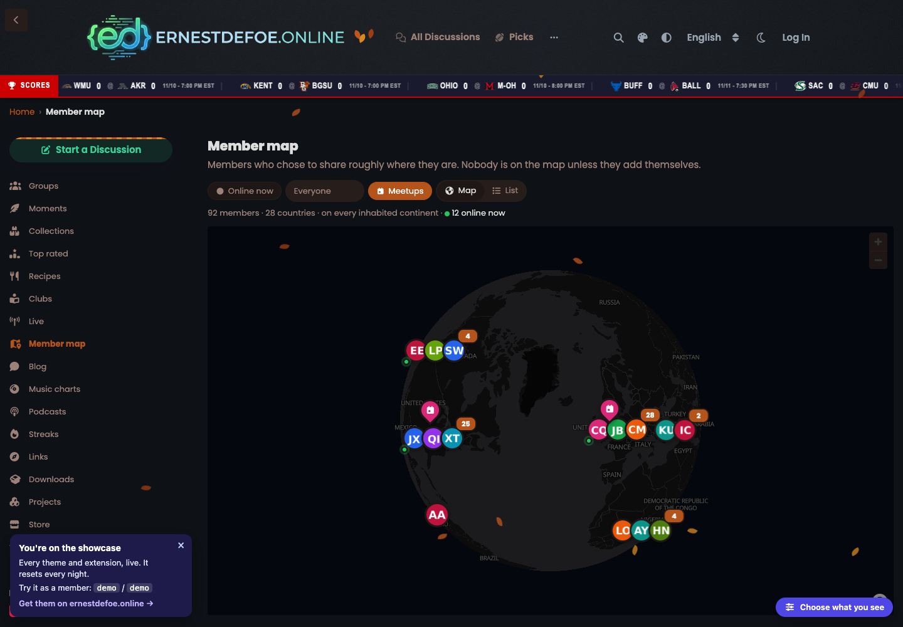

# Member Map

An opt-in map of where your community's members are, for Flarum 2.

 [](https://packagist.org/packages/ernestdefoe/member-map)



- **A living globe.** The map opens as a 3D globe and eases down to where your members are. Smooth vector maps (free OpenFreeMap tiles, no key), avatars as pins that stack into clusters, a soft pulse on everyone online right now, and a drop-in for newcomers. Follows dark mode.
- **Member cards** with their place, their local time ("3:42 PM there") and any trips, as popups on desktop and a bottom sheet on phones.
- **Travel pins.** "I'm visiting Chicago Dec 3–7": members who live nearby get a notification so you can meet up. The pin goes away by itself.
- **Meetups.** Plan one with a place and a time: it gets its own pin and a discussion, and goes on the calendar when the Calendar extension is installed.
- **Discovery.** Search the map for a place, filter by online now, group or people you follow (with Follow Users), see who is near you with rough distances, and a stats line: "58 members · 15 countries · 3 continents to go".
- **Everywhere.** A small map on profiles, a location line on user cards, and a "Where we are" widget for Bespoke, Page Builder and FoF Forum Widgets.
- **Privacy first.** Nobody is on the map until they add themselves. Members pick city, region or country, and the server saves only the **center of that place**, rounded, never the point they searched or tapped. Optional scatter within a city. Members can hide from guests and search engines, and remove themselves with one click. The map page is noindex and its data is never served to crawlers.
- **Accessible.** A list view of everyone grouped by country, keyboard-reachable pins with labels, and reduced motion respected.
- **Permissions** to view the map, appear on it, add travel pins and plan meetups. Guests can't see it unless you allow them.
- **Light on your forum.** The map engine loads only on the map page. All the map's markers come from one query; the profile line costs one query per page however many users it shows. Place lookups run on your server (Nominatim by default, swappable), one a second at most, cached 30 days.
- **GDPR**: with Flarum's GDPR extension, places and trips are part of a member's data export and are removed on erasure.

## Install

```sh
composer require ernestdefoe/member-map
```

## Update

```sh
composer update ernestdefoe/member-map
php flarum migrate
php flarum cache:clear
```

## Links

- [Packagist](https://packagist.org/packages/ernestdefoe/member-map)
- [GitHub](https://github.com/ernestdefoe/member-map)

Map data © [OpenStreetMap](https://www.openstreetmap.org/copyright) contributors. Vector tiles by [OpenFreeMap](https://openfreemap.org). Map engine: [MapLibre GL JS](https://maplibre.org).

☕ If this saves you time, you can [buy me a coffee](https://buymeacoffee.com/ernestdefoe).
